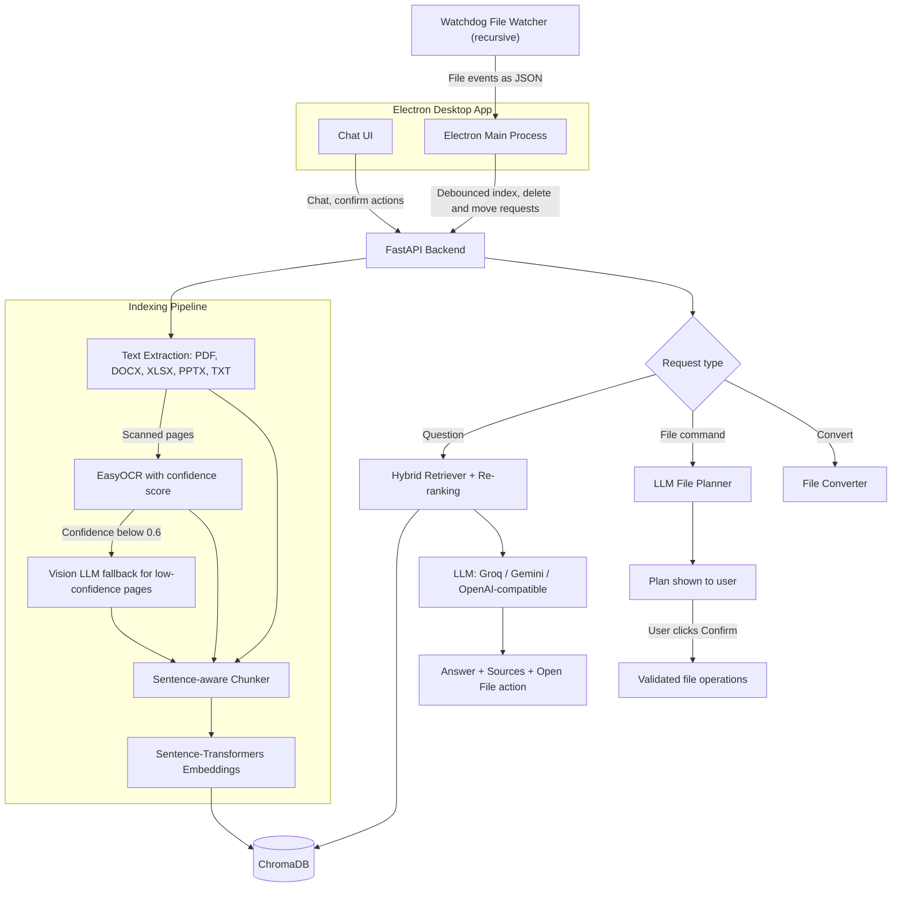

# HelixOS — AI Desktop Assistant for Your Local Files

HelixOS is a desktop application that lets you **search, ask questions about, and manage your local files in plain English**.

Point it at a folder and HelixOS keeps a live, searchable index of everything inside it: PDFs, Word, Excel, PowerPoint, text files and images, including **scanned and handwritten pages**. You can then chat with your files, find documents by describing them, and ask Helix to organize or convert files. Every file change is confirmed by you before it happens.

## Demo


## Key Features

- **Chat with your documents**: RAG answers grounded in your own files, with sources, confidence levels and a one-click "Open file" action
- **Real-time, recursive folder monitoring**: new, edited, deleted, renamed and moved files are reflected in the index automatically
- **Wide format support**: PDF, DOCX, XLSX/XLSM, PPTX, TXT, MD, CSV, LOG, PNG, JPG, WEBP, BMP, TIFF
- **Two-stage OCR for scanned pages**: EasyOCR first; pages it reads with low confidence (typically handwriting) go to a **vision LLM** for transcription
- **Hybrid retrieval with re-ranking**: semantic search, keyword matching and filename matching combined into one score
- **File management through chat**: "Create a folder named Major and move these files into it" becomes a plan you confirm before anything moves
- **File conversion through chat**: DOCX → PDF, PDF → TXT, PDF → PNG, Image → PDF, TXT → PDF
- **Multiple LLM providers**: Groq, Gemini, or any OpenAI-compatible API (including Ollama)
- **Can run fully locally**: disable the vision fallback and use a local model, and no document data leaves the machine

## System Architecture



## How It Works

### 1. Real-time indexing

1. The user selects a folder and starts monitoring. Electron spawns `watcher.py`, which uses **Watchdog** to watch the folder **recursively** and stream events as JSON lines. Folders like `.git`, `node_modules` and `venv` are ignored.
2. Rapid `modified` events are **debounced** (1 second per file), so a file that is saved repeatedly is processed only once.
3. **Moves and renames are handled cheaply.** The file's existing chunks and embeddings are re-keyed to the new path without re-extracting or re-embedding. This also handles whole-folder moves, and editors like Word that save by renaming a temp file onto the real name.
4. **The index heals itself.** On startup, chunks for files deleted while the app was closed are pruned. `sync_folder.py` brings a folder fully up to date after offline changes.

### 2. Text extraction and OCR

| File type | Method |
| --- | --- |
| PDF | `pypdf` text extraction, **page by page** |
| Scanned PDF pages | Pages with under 40 characters of digital text are rendered at 2× with `pypdfium2` and read with **EasyOCR** |
| Handwritten / low-quality pages | If EasyOCR's average confidence (weighted by text length) is **below 0.6**, the page image is sent to a **vision LLM** for transcription |
| DOCX | Paragraphs and tables (`python-docx`) |
| XLSX / XLSM | Each value is paired with its column header (e.g. `Amount: 500`) for better retrieval. Formulas are read as computed values, and sheets are capped at 5,000 rows |
| PPTX | Text boxes, tables, grouped shapes and speaker notes |
| TXT / MD / CSV / LOG | Read with encoding fallback (UTF-8 → UTF-8-SIG → Latin-1 → CP1252) |
| Images | EasyOCR |

**Vision fallback details:**
- Default models: Groq `qwen/qwen3.8-27b`, Gemini `gemini-2.5-flash`, OpenAI `gpt-4o-mini` (configurable)
- At most **20 pages per document** are sent, to limit cost and time
- **Rate-limit aware:** on HTTP 429 the client reads `retry-after` / `x-ratelimit-reset-*` headers and waits before retrying, so free-tier limits don't lose pages. It also retries on 5xx errors
- The prompt also extracts the **subject name** and a **one-line summary** of each page, which makes handwritten notes much easier to find later
- Set `VISION_FALLBACK=false` to keep all processing local

### 3. Chunking and storage

- **Sentence-aware chunking:** chunks of up to **500 characters** with **100 characters of overlap**, carried over as whole sentences. Very long sentences fall back to fixed-size slicing.
- **Embeddings:** `all-MiniLM-L6-v2` (Sentence-Transformers), normalized.
- **Vector store:** ChromaDB with cosine similarity. Chunk IDs are derived from a SHA-256 hash of the file path, so re-indexing a file **replaces** its chunks instead of duplicating them.

### 4. Hybrid retrieval and re-ranking

`all-MiniLM-L6-v2` gives short keyword queries similar scores in a narrow band (about 0.2–0.4), so pure vector search often ranks loosely related chunks above exact matches. HelixOS fixes this in three steps.

**1. Gather candidates from three sources:**
- **Semantic:** the top `max(top_k × 5, 25)` chunks by vector similarity
- **Filename:** all chunks of the 5 indexed files whose names best match the query
- **Keyword:** chunks that literally contain a query term (up to 50 per term)

**2. Re-rank every candidate:**

```
score = vector_similarity
      + 0.35 × (fraction of query terms in the filename)
      + 0.25 × (fraction of query terms in the chunk text)
```

Query terms are cleaned with stop-word removal and light stemming, and matched **fuzzily** (prefixes and close spellings, so "reciept" still matches "receipt").

**3. Filter and diversify:**
- File-type words in the query restrict results ("which **png** has the invoice" searches only images).
- Results are limited to the **top 4 distinct files**, with at most **2 chunks per file**, merged in document order. One long file can't crowd out everything else.
- Files that no longer exist on disk are removed from the index as they're found.
- A confidence level (high / medium / low / uncertain) is attached to every answer.

### 5. File management through chat

Requests like *"Create a folder named Major and move these 4 documents into it"* are handled safely:

1. A cheap regex pre-filter detects possible file commands, so normal questions don't pay for an extra LLM call.
2. The LLM (temperature 0) converts the request into a **JSON plan**. It may only pick paths from the list of files actually in the workspace. "These" or "those" refer to the files shown in the previous answer.
3. **Partial plans are refused.** If any mentioned file can't be matched exactly, nothing is changed and the user is asked to clarify.
4. The plan is shown to the user, and **nothing happens until they click Confirm**.
5. On execution, everything is **validated again on the server** (the plan comes back from the client and isn't trusted):
   - every path must resolve inside the workspace (`realpath` + `commonpath`, which blocks `..` tricks and symlinks)
   - folder names are checked against Windows rules (invalid characters and reserved names like `CON`, `NUL`)
   - name clashes are resolved as `report (1).pdf` instead of overwriting
   - moved files keep their index entries through re-keying

## Technology Stack

| Component | Technology |
| --- | --- |
| Desktop App | Electron, JavaScript, HTML/CSS |
| Backend API | Python, FastAPI, Uvicorn, Pydantic |
| File Monitoring | Watchdog |
| Document Parsing | pypdf, pypdfium2, python-docx, openpyxl, python-pptx |
| OCR | EasyOCR + vision LLM fallback |
| Embeddings | Sentence-Transformers (`all-MiniLM-L6-v2`) |
| Vector Database | ChromaDB |
| LLM Providers | Groq, Gemini, OpenAI-compatible APIs |
| HTTP Client | httpx |

## API Endpoints

| Method | Endpoint | Description |
| --- | --- | --- |
| `POST` | `/api/chat` | Ask a question or give a file command; returns answer, sources, action and confidence |
| `POST` | `/api/search` | Hybrid search across indexed files |
| `POST` | `/api/index/file` | Extract, chunk, embed and index a file |
| `DELETE` | `/api/index/file` | Remove a file from the index |
| `POST` | `/api/index/move` | Update the index after a file or folder is moved or renamed |
| `POST` | `/api/files/execute` | Run a user-confirmed file plan (create folder, move/copy files) |
| `POST` | `/api/convert` | Convert a file to another format |
| `GET` | `/api/health` | Backend status, indexed chunk count and LLM configuration |

Interactive API docs: `http://127.0.0.1:8000/docs` (while the backend is running).

## Project Structure

```text
HelixOS/
├── backend/
│   ├── api/
│   │   └── routes.py              # FastAPI endpoints
│   ├── core/
│   │   ├── document_processor.py  # Text extraction for all formats + OCR
│   │   ├── vision_ocr.py          # Vision LLM fallback with rate-limit-aware retries
│   │   ├── chunker.py             # Sentence-aware chunking
│   │   ├── embedder.py            # Sentence-Transformers embeddings
│   │   ├── vector_store.py        # ChromaDB: add, delete, re-key on move, prune
│   │   ├── indexer.py             # Extract → chunk → embed → store; move handling
│   │   ├── filesystem_search.py   # Filename search on disk
│   │   ├── file_ops.py            # Validated, workspace-confined file operations
│   │   └── converter.py           # File format conversion
│   ├── models/
│   │   └── schemas.py             # Pydantic request/response models
│   ├── rag/
│   │   ├── retriever.py           # Hybrid retrieval + re-ranking
│   │   ├── file_commands.py       # Chat command → JSON file plan
│   │   ├── llm_client.py          # Multi-provider LLM client
│   │   └── service.py             # Request routing and RAG orchestration
│   ├── config.py                  # Settings loaded from .env
│   └── main.py                    # FastAPI app, startup index pruning
├── main.js                        # Electron main process: backend, watchers, debouncing
├── renderer.js                    # Chat UI
├── index.html
├── style.css
├── watcher.py                     # Recursive Watchdog file monitor
├── sync_folder.py                 # Re-sync a folder after offline changes
├── requirements.txt
├── package.json
└── .env.example
```

## How to Run

### Prerequisites

- Python 3.10+
- Node.js 18+

### Setup

```bash
git clone https://github.com/vishalbhor0810-droid/HelixOS.git
cd HelixOS

python -m venv venv
venv\Scripts\activate          # Windows (macOS/Linux: source venv/bin/activate)
pip install -r requirements.txt

npm install
```

### Configure

Copy `.env.example` to `.env` and set your LLM provider and key:

```env
LLM_PROVIDER=groq
LLM_API_KEY=your_api_key_here
LLM_MODEL=llama-3.1-8b-instant

# Send low-confidence scanned pages to a vision model (set false to stay fully local)
VISION_FALLBACK=true
```

See `.env.example` for all options (similarity threshold, chunks per file, vision limits).

### Start

```bash
npm start
```

This opens the desktop app and starts the FastAPI backend on `http://127.0.0.1:8000` automatically.

To run only the backend (for example, to test the API in Swagger):

```bash
python backend/main.py
```

To sync a folder that changed while the app was closed:

```bash
python sync_folder.py "C:\path\to\folder"
```

## Known Limitations and Future Work

- **Desktop hardening:** the Electron window runs with Node integration enabled. Moving to a preload script with `contextIsolation` would reduce the impact of any malicious content rendered in the UI.
- **Conversion confinement:** file conversion should apply the same workspace path checks used for file operations.
- **Retrieval evaluation:** add a labelled query set to measure precision/recall and tune the re-ranking weights systematically.
- **Packaging:** ship as an installable app (e.g. `electron-builder`) with a bundled Python runtime.
